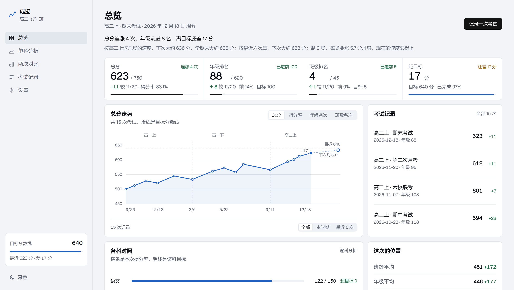

<h1 align="center">成迹</h1>

<p align="center">
  <b>记下每次考试的分数和名次，看清走势、偏科，和离目标还差多少。</b><br>
  不用安装，不用注册，不用联网，成绩只存在你自己的浏览器里
</p>

<p align="center">
  <a href="LICENSE"></a>
  <a href="https://ndhnzr6r.github.io/chengji/"></a>
  <a href="https://github.com/nDhnzr6r/chengji/stargazers"></a>
  
  
  
</p>

<p align="center">
  <a href="https://ndhnzr6r.github.io/chengji/">在线试用</a> ·
  <a href="#快速开始">快速开始</a> ·
  <a href="#能做什么">能做什么</a> ·
  <a href="#从表格导入">从表格导入</a> ·
  <a href="#数据存在哪">数据存在哪</a> ·
  <a href="#文件结构">文件结构</a>
</p>

<p align="center">
  <picture>
    <source media="(prefers-color-scheme: dark)" srcset="docs/overview-dark.png">
    
  </picture>
</p>

## 能做什么

- **一句话说清现状**：标题下面两行，第一行是最近几次的概括（涨了几次、名次动了几名、离目标差多少），第二行给出按当前速度估的下次和学期末。
- **走势会往后延伸**：四个指标随意切（总分、得分率、年级名次、班级名次），末端按拟合速度多画一个空心点，标着下次大概多少。
- **分得清题难还是状态差**：填了班级平均之后，页面会算出你比班平高多少、离年级最高差多少，并用分差的变化判断这次是卷子难还是自己掉了。
- **知道先补哪一科**：六科按缺口占满分的比例排序，还给出「这一科再多考十分，总分能到多少、年级大约进几名」。
- **按学期和类型看**：记录页可以只看月考、期中、期末或联考；每次考试自动归到高一上、高一下这样的学期里。
- **能带走**：导出 Excel、CSV、完整 JSON 备份，或者一份含结论和建议的 HTML 报告。侧栏最底下切换深浅色，选择会记住；打印样式也做了。

## 快速开始

前提：一台装了 Chrome 或 Edge 的电脑。不需要 Node。

**方式一，直接用网页版**：打开 <https://ndhnzr6r.github.io/chengji/>。

**方式二，放到本地**（断网也能用，数据不受网站访问速度影响）：

1. 拿到文件。用 git 的话：

   ```bash
   git clone https://github.com/nDhnzr6r/chengji.git
   ```

   不想用 git 就点页面右上角 **Code → Download ZIP**，解压。

2. 双击目录里的 `index.html`。

接下来两种方式一样：页面会带着 15 场示例考试打开，顶部有一条褐色提示，写明这些是虚构的。点「清空并开始记录」，确认后回到空白状态，再点右上角「记录一次考试」录第一场。

**跑通的标准**：清空后总览页显示「还没有任何成绩记录」，录完一场之后，总分、走势图和记录列表都出现了你自己的数字。

第一次打开还会有一个八步导览，走完不再出现；想重看去设置页点「看一遍导览」。

> 网页版和本地版是两份独立的数据 —— 浏览器按来源隔离存储，`https://` 和 `file://` 各存各的。在一边录的成绩不会自动出现在另一边，需要靠导出的 JSON 备份搬过去。

## 五个页面

**总览** — 结论句、预测行、四格指标、走势图、各科对照、这次的位置（和班平比）、先补哪一科、各类型平均分。一屏基本能看完。

**单科分析** — 挑一科，看它自己的走势、历次平均、波动幅度、最高最低、每场的班内名次。切科时只换数据，不刷新整页。

**两次对比** — 选任意两次考试，看总分、名次、得分率的进退，每科差多少用一条以零线为中心的横条表示；右边是叠在一起的两张六科形状。底下还有各学期平均的比较。

**考试记录** — 按学期分组，可按考试类型筛选。点一行看当次的六科分数、名次和较上一场的变化。

**设置** — 目标、人数、及格线、科目与满分、考试类型、数据导入导出、数据检查。

## 记录与修改

点右上角「记录一次考试」，填名称、日期和六科分数，合计会实时算出来。名次可以不填。

表单底部有个收起的「参照数据和单科名次」，展开能填这场考试的班级平均、年级平均、年级最高分，以及各科在班级里的名次和各科的班级平均分。不填不影响使用，只是判断和预测不会出现。

录错了不用删掉重来：在考试详情页点「修改这次」，表单会带着当时的数据打开，改完保存，走势、名次变化、两次对比都会重算。

## 从表格导入

设置页有「导入 CSV」和「导入 Excel」。表头需要有这些列（顺序可以不同，缺的科目列会跳过）：

```
考试名称, 日期, 类型, 语文, 数学, 英语, 物理, 化学, 生物,
语文名次, 数学名次, 英语名次, 物理名次, 化学名次, 生物名次,
语文平均, 数学平均, 英语平均, 物理平均, 化学平均, 生物平均,
班级排名, 年级排名, 班级平均, 年级平均, 年级最高
```

日期支持 `2026-11-05`、`2026/11/5`、`2026年11月5日`，也认 Excel 存成的日期数字。

考试按「日期 + 名称」识别：同日期同名称再导一次是覆盖，不会出现两条。设置页的「下载导入模板」会给一份填好示例行的 CSV，照着填完导进来就行。

仓库里的 `默认数据.csv` 和 `默认数据.json` 就是那 15 场示例数据，可以参考，也可以直接导回去。

## 数据存在哪

存在浏览器的 localStorage 里，键名 `scorebook.v2`。这个应用不联网，服务端没有任何副本。

因此：

- 换浏览器打开是另一份数据，不会跟过去；
- 清理浏览器数据会删掉成绩；
- 无痕窗口关掉就没了；
- 换电脑得先导出备份。

打开时会向浏览器申请持久化存储，减少磁盘紧张时被整体清理的可能，结果在设置页的「存储」里能看到。

**存不进去会说出来**：浏览器空间满了，或者当前窗口不让写，页面顶部会出现一条提示，写明原因，并给出「导出备份」的按钮 —— 不会让你以为已经存好了。

**读不出来也不丢**：存档被改坏时，原始内容会原样复制到 `scorebook.v2.broken`，顶部提示可以把它下载下来检查，不会被下一次保存冲掉。

「导出备份（JSON）」是完整备份 —— 目标、科目、人数、类型、全部考试，包括单科名次和各科平均，导入时一并恢复。「导出表格」是纯表格，只有考试记录。成绩重要的话，隔一段时间导一份 JSON 存到别处。

## 设置项

| 项 | 作用 |
| --- | --- |
| 目标总分 | 走势图上的虚线位置；填 0 时按各科目标分相加 |
| 目标班级/年级排名 | 排名格右上角判断达标与否的依据 |
| 离目标还剩几场 | 用来算每场需要涨多少分 |
| 及格线 / 优秀线 | 各科达标统计的分界，默认 60% 和 85% |
| 班级人数 / 年级人数 | 算排名百分比，也用来校验名次是否越界 |
| 入学年份 | 决定 2025 年 9 月算高一上还是别的 |
| 考试类型 | 可以增删改名，已有考试会跟着改 |
| 存储 | 本地存储能否写入、长期保留是否获准、当前占用多少、有没有损坏的留底 |
| 数据检查 | 扫描分数超满分、名次超人数、重复记录这类问题 |

## 文件结构

```
index.html          页面入口
favicon.svg         标签页图标
assets/store.js     数据模型、全部计算、导入导出、本地存储
assets/views.js     各页面的 HTML 生成
assets/app.js       路由、交互、表单、导出
assets/charts.js    走势图、雷达图、对照条
assets/ui.js        下拉与日期控件
assets/tour.js      首次打开的导览
assets/app.css      全部样式，含深浅色和打印
vendor/             本地依赖（Excel 解析、Geist 字体）
tests/              自动测试
package.json        测试命令
CHANGELOG.md        更新记录
.github/workflows/  推送后自动跑测试
```

没有构建步骤：改完源文件直接刷新浏览器就生效。

## 测试

装着 Node 20 或更新的版本，在项目根目录运行：

```bash
npm test
```

28 项，覆盖预测拟合、排名换算、学期归属、表格解析、日期解析和存储异常。每次推送到 master 会自动跑一遍，结果在仓库的 Actions 页能看到。

## 贡献

这是给自己用的工具，但欢迎提 Issue 说哪里不好用、哪里算错了。改动代码之前先开个 Issue 聊一下，避免做完发现方向不对。

## 许可证

GNU General Public License v3.0，见 [LICENSE](LICENSE)。
